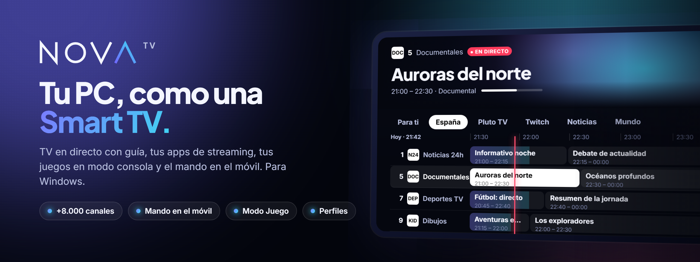
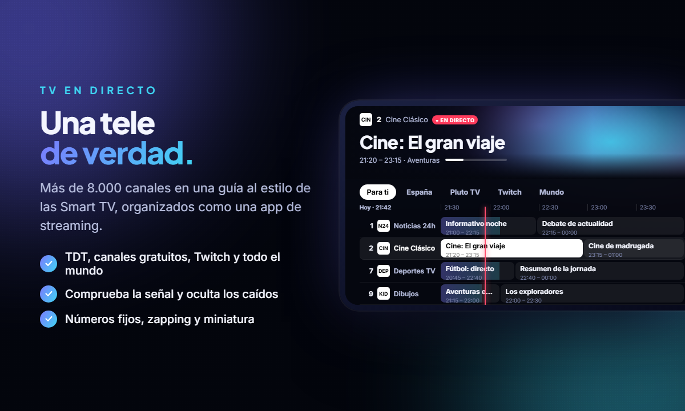
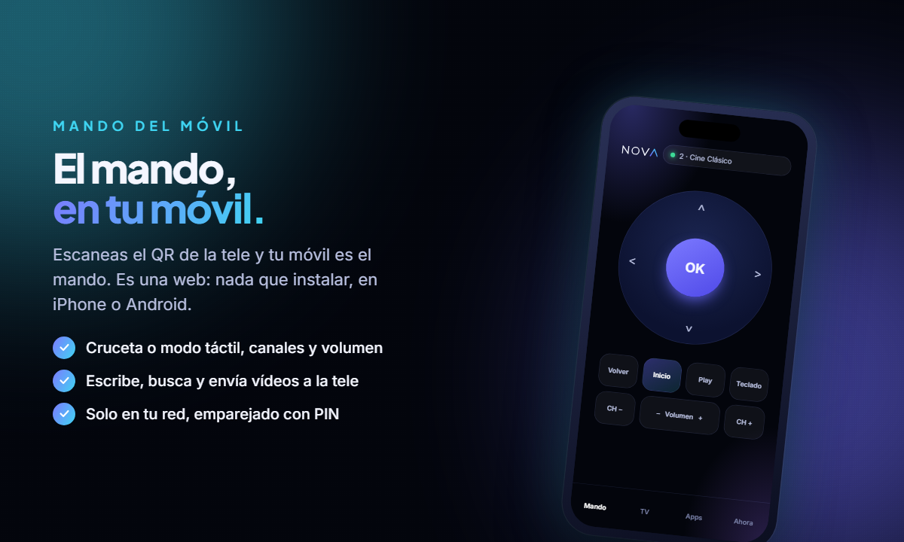
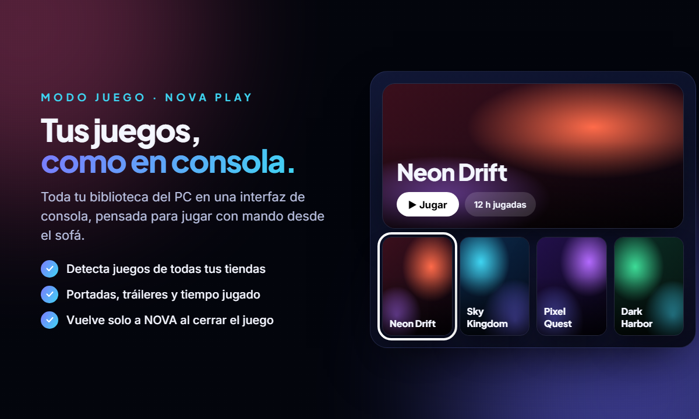

<picture>
  <source media="(prefers-color-scheme: dark)" srcset="assets/logo-light.svg" />
  <source media="(prefers-color-scheme: light)" srcset="assets/logo-dark.svg" />
  
</picture>

### Tu PC, como una Smart TV.

TV en directo con guía, tus apps de streaming, tus juegos en modo consola y el mando en el móvil.

 

  

## Descargar e instalar

1. Entra en [**la última versión**](../../releases/latest) y descarga `NOVA-TV_x.y.z_x64-setup.exe`.
2. Ábrelo y sigue los pasos. Se instala solo para tu usuario, sin pedir permisos de administrador.
3. Para usar el móvil como mando: en NOVA ve a **Ajustes → Mando del móvil** y escanea el código QR, con el móvil en el mismo Wi-Fi.

**Requisitos:** Windows 10 u 11 de 64 bits. NOVA usa WebView2, que ya viene con Windows.

> [!NOTE]
> La primera vez, Windows puede mostrar **"Windows protegió su PC"** porque el instalador aún no tiene un certificado de empresa. Pulsa **Más información → Ejecutar de todas formas**. Las actualizaciones posteriores sí van firmadas y NOVA las comprueba antes de instalarlas (ver abajo).

## Qué trae

<table>
  <tr>
    <td width="50%"></td>
    <td width="50%"></td>
  </tr>
  <tr>
    <td valign="top"><b>TV en directo.</b> TDT española, Pluto TV, directos de Twitch y miles de canales públicos del mundo, en una guía por horas con números de canal fijos.</td>
    <td valign="top"><b>Mando en el móvil.</b> Escanea el QR y tu móvil es el mando: cruceta, teclado, canales, volumen y "enviar a la tele".</td>
  </tr>
  <tr>
    <td width="50%"></td>
    <td width="50%"></td>
  </tr>
  <tr>
    <td valign="top"><b>Modo Juego.</b> Tus juegos de todas las tiendas en una interfaz de consola, con portadas y tiempo jugado.</td>
    <td valign="top"><b>Perfiles y control parental.</b> Favoritos e historial por persona; los perfiles infantiles solo ven lo apto, con PIN.</td>
  </tr>
</table>

## Actualizaciones

NOVA se actualiza desde aquí. Al poco de abrirse, y luego cada 6 horas, mira si hay una versión nueva; si la hay, te avisa y te enseña sus novedades. Se instala **solo cuando tú pulsas "Actualizar"**: NOVA se cierra un momento y vuelve ya actualizado, con tus perfiles, canales y ajustes intactos.

También puedes buscarlas a mano en **Ajustes → Actualizaciones**, o desactivar la búsqueda automática.

**Cómo se comprueban.** Cada versión publicada aquí incluye:

| Archivo | Para qué |
|---|---|
| `NOVA-TV_x.y.z_x64-setup.exe` | El instalador. |
| `latest.json` | La versión más reciente, sus novedades y la firma del instalador. Es lo que NOVA consulta. |

NOVA solo instala una actualización si su firma coincide con la clave pública que lleva dentro. Si alguien cambiara el archivo, la firma no coincidiría y NOVA no lo instalaría.

## Privacidad

Todo lo que NOVA recuerda se guarda en tu PC: no hay cuentas, ni anuncios propios, ni servidores de NOVA. Lo único que consulta este repositorio es si hay una versión nueva.

## Novedades

El historial de cambios de cada versión está en [**Releases**](../../releases).

## Sobre este repositorio

Aquí solo se publican las versiones de NOVA TV para descargar y actualizar. El código fuente es privado.

> Twitch, Pluto TV, YouTube, Steam, Microsoft Store y el resto de marcas citadas pertenecen a sus respectivos propietarios. NOVA TV es un proyecto independiente y no está afiliado a ninguno de ellos.

© 2026 ivnovomi. Todos los derechos reservados. Ver [LICENSE](LICENSE).
